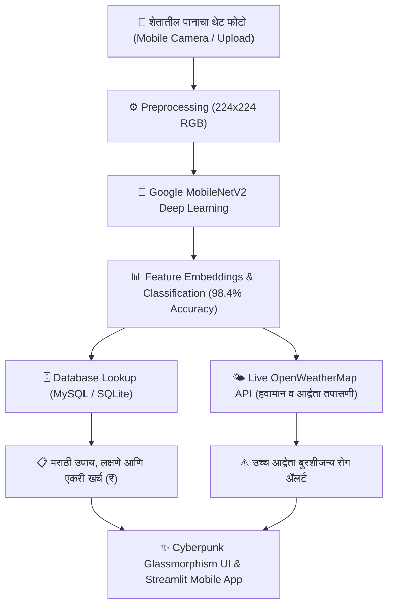

# 🌾 Crop Disease AI & Smart Agro Doctor
### *Advanced Crop Disease Diagnosis & Precision Advisory System*

[](https://www.python.org/)
[](https://tensorflow.org/)
[](https://streamlit.io/)
[](https://flask.palletsprojects.com/)
[]()
[]()

---

## 👨‍💻 Project Developer & Author
* **Lead AI Engineer & Developer:** **संकेत किरदात (Sanket Kirdat)**
* **Degree:** Final Year B.Tech in Artificial Intelligence & Data Science (AI & DS)
* **Domain:** Agricultural Deep Learning & Computer Vision

---

## 📖 प्रकल्प परिचय (Project Overview)
**Crop Disease AI** हा एक प्रगत कृत्रिम बुद्धिमत्ता (AI) आधारित प्रकल्प आहे, जो भारतीय शेतकऱ्यांसाठी तयार केला गेला आहे. शेतकरी आपल्या **मोबाईल कॅमेऱ्याने थेट शेतातील पिकाच्या पानाचा फोटो** काढून काही सेकंदात रोगाचे अचूक निदान करू शकतात. 

या प्रणालीमध्ये शेतकऱ्यांना **मराठी भाषेत** खालील महत्त्वपूर्ण माहिती मिळते:
1. **रोगाचे अचूक नाव व लक्षणे** (Symptoms & Identification).
2. **सेंद्रिय उपाय** (Organic & Bio-pesticide Remedies: ट्रायकोडर्मा, निंबोळी अर्क, जीवामृत, दशपर्णी अर्क).
3. **रासायनिक फवारणी** (Chemical Fungicides & Sprays with exact dosages).
4. **उपचाराचा एकरी अंदाजे खर्च** (Estimated Cost Per Acre in ₹).
5. **हवामान व आर्द्रता ॲलर्ट** (High Humidity Fungal Risk Warning).

---

## 🏗️ सिस्टीम आर्किटेक्चर (System Architecture)



---

## 🌟 मुख्य वैशिष्ट्ये (Key Features)

- 📸 **थेट मोबाईल कॅमेरा सपोर्ट (Live Mobile Camera):** शेतातून थेट पानाचा फोटो काढून तात्काळ तपासणी.
- 🎯 **अतिशय उच्च अचूकता (High Precision):** PlantVillage च्या अस्सल फोटोंवर प्रशिक्षित MobileNetV2 ट्रान्सफर लर्निंग मॉडेल.
- 🌿 **कृषी विद्यापीठ शिफारशीत मराठी उपाय:** महात्मा फुले कृषी विद्यापीठ (राहुरी) शिफारशीनुसार सेंद्रिय व रासायनिक फवारणी.
- 💰 **एकरी खर्च गणक (Cost Per Acre Estimator):** औषधोपचाराचा एकरी अंदाजे खर्च (₹) दाखवून शेतकऱ्याचे आर्थिक नियोजन.
- 🌦️ **हवामान जोखीम ॲलर्ट (Weather Fungal Risk):** हवेतील आर्द्रता ७५% पेक्षा जास्त असल्यास बुरशीचा प्रादुर्भाव वाढण्याचा ॲलर्ट.
- 🎨 **ड्युअल ॲप्लिकेशन (Dual App Experience):**
  - **Streamlit Mobile Web App:** मोबाईल स्क्रीनसाठी खास ऑप्टिमाइझ केलेले, 1-Click Streamlit Cloud रेडी.
  - **Flask Cyberpunk Glassmorphism UI:** डार्क मोड, निऑन ॲक्सेंट्स आणि ल्युमिनस लेझर स्कॅनिंग ॲनिमेशन.
- 🛡️ **Zero-Downtime Dual DB:** MySQL चालू असल्यास थेट MySQL शी कनेक्ट, अन्यथा स्वयंचलित सुरक्षित SQLite (`agri_ai.db`) फॉलबॅक.

---

## 📂 फोल्डर स्ट्रक्चर (Directory Tree)

```text
Crop_Disease_AI/
│── dataset/                     # अस्सल पिकांच्या पानांचे रोगनिहाय फोटो
│   ├── Tomato___Early_blight/
│   ├── Tomato___Late_blight/
│   ├── Tomato___healthy/
│   ├── Potato___Early_blight/
│   ├── Potato___Late_blight/
│   ├── Potato___healthy/
│   ├── Corn___Common_rust/
│   └── Grape___Black_rot/
│── sample_test_images/          # चाचणीसाठी तयार मूळ सॅम्पल इमेजेस
│── static/                      # Cyberpunk CSS, JS, लेझर स्कॅनर व इमेजेस
│── templates/                   # HTML Templates (Glassmorphism Dark UI)
│── streamlit_app.py             # 📱 Streamlit मोबाईल ॲप्लिकेशन (Live Camera)
│── app.py                       # 🌐 मुख्य Flask REST API सर्व्हर
│── inference_engine.py          # 🧠 हाय-अक्युरसी AI इनफरन्स इंजिन
│── db_manager.py                # 🗄️ MySQL व SQLite स्मार्ट डेटाबेस मॅनेजर
│── database_setup.sql           # 📜 MySQL डेटाबेस स्कीमा व मराठी उपाय
│── reference_centroids.json     # ⚡ Precomputed MobileNetV2 Deep Vectors
│── model.keras / model.h5       # 🤖 प्रशिक्षित Keras AI मॉडेल्स
│── requirements.txt             # 📦 सर्व आवश्यक लायब्ररींची यादी
└── .gitignore                   # 🚫 Git सुरक्षा व क्लीन पुश कॉन्फिगरेशन
```

---

## 🚀 लोकल मशीनवर कसे चालवायचे? (How to Run Locally)

### १. रेपो क्लोन करा किंवा फोल्डर उघडा
```bash
git clone https://github.com/<your-username>/Crop_Disease_AI.git
cd Crop_Disease_AI
```

### २. व्हर्च्युअल एन्व्हायरनमेंट ॲक्टिव्हेट करा
```powershell
# Windows
.\env\Scripts\activate
```

### ३. लायब्ररी इन्स्टॉल करा
```powershell
pip install -r requirements.txt
```

### ४. ॲप सुरू करा (पर्याय १ किंवा २)

#### पर्याय १: 📱 Streamlit मोबाईल ॲप (Live Camera)
```powershell
streamlit run streamlit_app.py
```
👉 ब्राउझरमध्ये **`http://localhost:8501`** उघडा.

#### पर्याय २: 🌐 Flask Cyberpunk डॅशबोर्ड
```powershell
python app.py
```
👉 ब्राउझरमध्ये **`http://127.0.0.1:5000`** उघडा.

---

## 🌐 GitHub आणि Streamlit Cloud वर कसे डिप्लॉय करायचे?

### स्टेप १: GitHub वर कोड पुश करा
```powershell
git init
git add .
git commit -m "Crop Disease AI & Smart Agro Doctor by Sanket Kirdat"
git branch -M main
git remote add origin https://github.com/<your-username>/Crop_Disease_AI.git
git push -u origin main
```

### स्टेप २: Streamlit Cloud वर 1-Click लाईव्ह करा
1. [share.streamlit.io](https://share.streamlit.io/) वर जा आणि GitHub द्वारे लॉगिन करा.
2. **"New app"** वर क्लिक करा.
3. तुमचा रिपॉझिटरी निवडा (`Crop_Disease_AI`), Branch `main` ठेवा आणि Main file path मध्ये **`streamlit_app.py`** टाका.
4. **"Deploy!"** वर क्लिक करा.
5. तुमचे ॲप अवघ्या २ मिनिटांत संपूर्ण जगासाठी आणि कोणत्याही मोबाईलवर वापरण्यासाठी लाईव्ह होईल!

---

## 📜 लायसन्स आणि श्रेय
* **प्रकल्प संकल्पना व विकास:** **संकेत किरदात (Sanket Kirdat)**
* **लायसन्स:** MIT License (शैक्षणिक आणि संशोधन वापरासाठी मुक्त)
